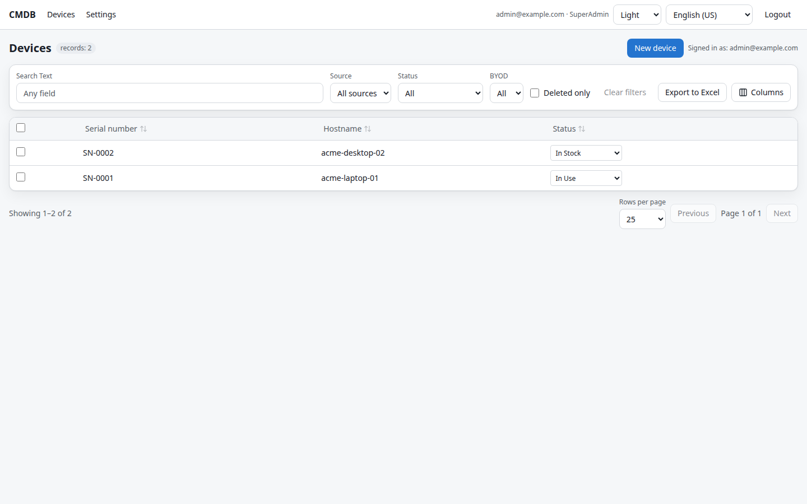
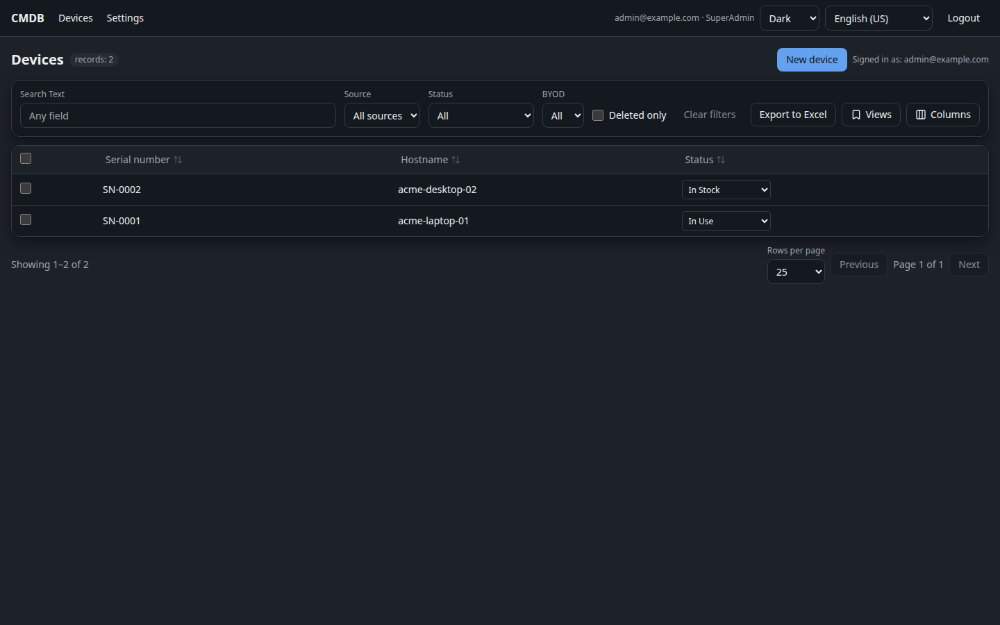
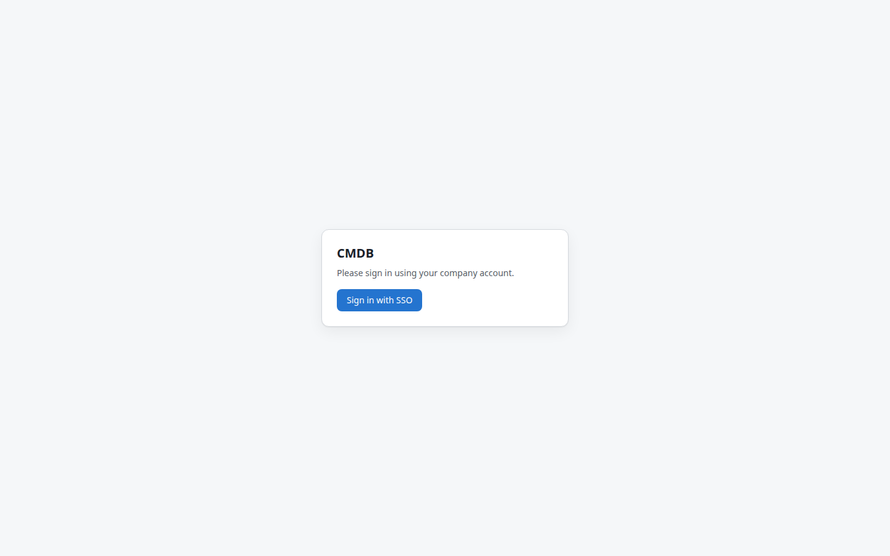
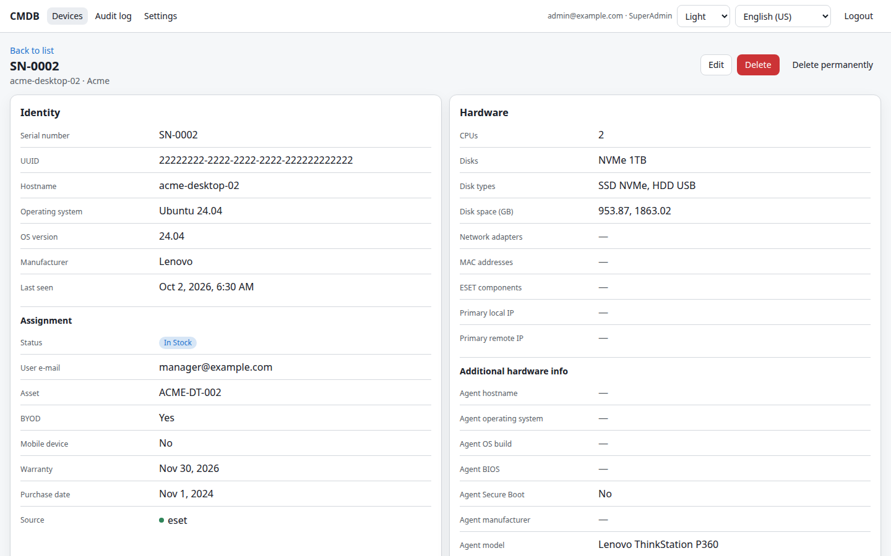
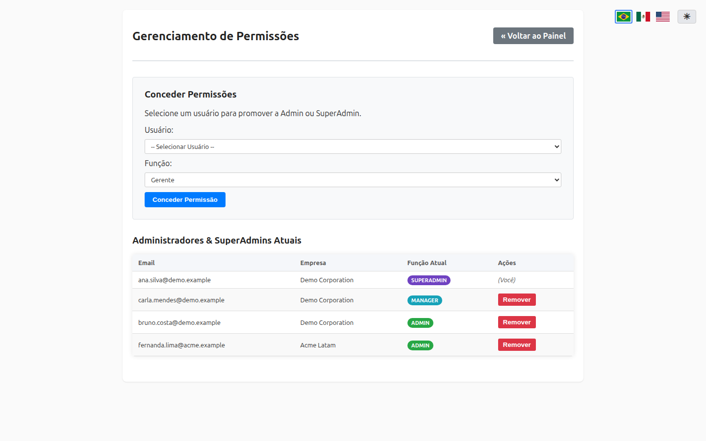
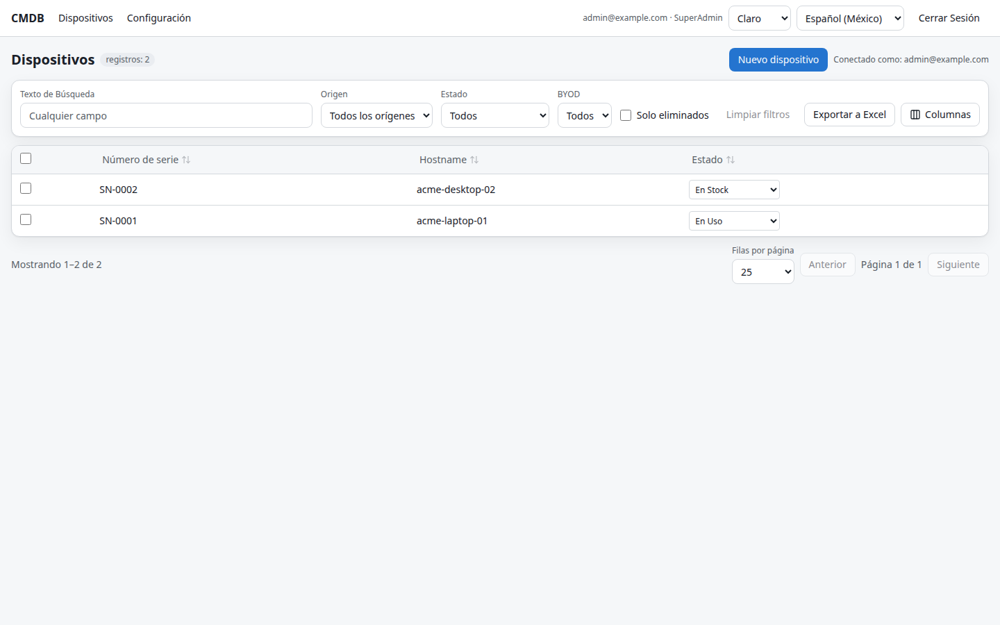

# Bundled CMDB
Small CMDB project that uses ESET data sent to database for asset management, uses Keycloak as SSO provider for user authentication, S3 for file submission and access related to each asset

<!-- buttons -->
[](https://github.com/ivancarlosti/bundledcmdb/stargazers)
[](https://github.com/sponsors/ivancarlosti)
[](https://github.com/sponsors/ivancarlosti)
[](https://github.com/ivancarlosti/bundledcmdb/releases)
[](https://github.com/ivancarlosti/bundledcmdb/pulse)
[](https://github.com/ivancarlosti/bundledcmdb/issues)  
[](LICENSE)
[](https://github.com/ivancarlosti/bundledcmdb/commits)
[](https://github.com/ivancarlosti/bundledcmdb/security)
[](https://github.com/ivancarlosti/bundledcmdb?tab=coc-ov-file)
<!-- endbuttons -->

## Requirement:

* [Docker Compose](https://docs.docker.com/engine/install/)
* MySQL/MariaDB
* Keycloak for SSO
* S3-like for object storage
* ESET data to populate

## Deployment instructions:

* Download `/docker` files on your server, example:
```
curl -o .env https://raw.githubusercontent.com/ivancarlosti/bundledcmdb/main/docker/.env
curl -o docker-compose.yml https://raw.githubusercontent.com/ivancarlosti/bundledcmdb/main/docker/docker-compose.yml
```
* Edit both `.env`, `docker-compose.yml` files
* Start Docker Compose, example:
```
docker compose pull && docker compose up -d
```
* Apply the schema migrations (idempotent; safe to re-run):
```
docker compose exec ddnsonroute53 php bin/migrate.php
```

## What's new in 1.1

* **REST API for devices** — `POST/PATCH/DELETE /api/v1/devices`, upsert and bulk
  endpoints, per-key company/source scopes, IP allowlists, token rotation.
  See [docs/api.md](docs/api.md).
* **Source per asset** — `assets.source` (seeded `eset`, `api`, `manual`, plus
  any custom source), shown as badges and filterable in the grid.
* **Panel-side asset management** — create assets (`asset_new.php`), edit them
  with attachments, soft-delete from the grid.
* **Settings page** (`settings.php`, admin/superadmin) — language combo (7
  locales), timezone, S3 storage (secret encrypted with `APP_ENCRYPTION_KEY`),
  API keys, sources, custom fields and schema maintenance. Values are stored in
  the database with `DB → ENV → default` precedence; see
  [docs/settings.md](docs/settings.md).
* **Dynamic custom fields** (EAV) — text, textarea, integer, decimal, date,
  datetime, boolean, single/multi choice, e-mail, URL, IP; validation, unique
  constraints, per-role editing, per-locale labels, grid columns and search.
* **Schema migrations** — `bin/migrate.php` (+ Settings → Maintenance button),
  `docker/schema.sql` for DBA-managed databases. No manual `ALTER TABLE` needed.

### New environment variables

| Variable | Purpose |
|---|---|
| `APP_ENCRYPTION_KEY` | 32-byte key (base64/hex) that encrypts panel secrets. `openssl rand -base64 32` |
| `APP_DEFAULT_LOCALE` | Optional fallback for the default language |
| `APP_TIMEZONE` | Optional fallback for the timezone |
| `APP_VERSION` | Shown by `/api/v1/health` |
| `APP_ENV` | `production` (default) or `development`; `production` disables the development login |
| `APP_DEV_LOGIN` | `1` enables `/auth/dev-login?email=…` **outside production only** (local UI work without Keycloak) |
| `KEYCLOAK_PANEL_REDIRECT_URI` | Callback registered for `/auth/callback`. Empty = derive `https://<host>/auth/callback` from the request |
| `DB_PORT` | Optional non-default database port |

S3 variables remain supported as fallbacks, but the panel values take
precedence and encrypt the secret.

### Languages

`en-US`, `pt-BR`, `es-MX`, `fr-FR`, `zh-CN`, `hi-IN`, `ar-SA` (RTL), selected
from a combo box in every page toolbar. Catalogues live in
`public/lang/<code>.php`; `php bin/check-i18n.php` validates them and prints
coverage.

### Developer docs

* [docs/api.md](docs/api.md) — API reference and curl examples.
* [docs/settings.md](docs/settings.md) — settings precedence, encryption,
  sources, custom fields, migrations.
* [docs/development.md](docs/development.md) — local stack, CLI tools, layout,
  validation checklist.
* [docs/frontend.md](docs/frontend.md) — React SPA: structure, `npm` scripts,
  local `vite` workflow, conventions and i18n rules
  (migration plan: [`plans/2026-11-02-spa-migration.md`](plans/2026-11-02-spa-migration.md)).

## 📸 Screenshots

Captured from the Docker image with demo data (no production or customer data).

| Asset dashboard — light theme | Asset dashboard — dark theme |
|---|---|
|  |  |

<sub>Light/dark/system theme and the language combo (7 locales, including RTL) are available in the top-right corner of every page.</sub>

### Login with Keycloak SSO


### Asset detail and file attachments


### Manage permissions (SuperAdmin)


### Language switcher (es_MX)


<!-- footer -->
---

## 🧑‍💻 Consulting and technical support
* For personal support and queries, please submit a new issue to have it addressed.
* For commercial related questions, please [**contact me**][ivancarlos] for consulting costs.

[cc]: https://docs.github.com/en/communities/setting-up-your-project-for-healthy-contributions/adding-a-code-of-conduct-to-your-project
[contributing]: https://docs.github.com/en/articles/setting-guidelines-for-repository-contributors
[security]: https://docs.github.com/en/code-security/getting-started/adding-a-security-policy-to-your-repository
[support]: https://docs.github.com/en/articles/adding-support-resources-to-your-project
[it]: https://docs.github.com/en/communities/using-templates-to-encourage-useful-issues-and-pull-requests/configuring-issue-templates-for-your-repository#configuring-the-template-chooser
[prt]: https://docs.github.com/en/communities/using-templates-to-encourage-useful-issues-and-pull-requests/creating-a-pull-request-template-for-your-repository
[funding]: https://docs.github.com/en/articles/displaying-a-sponsor-button-in-your-repository
[ivancarlos]: https://ivancarlos.me
