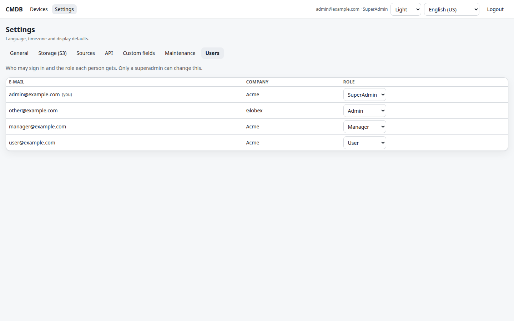

# Bundled CMDB
Small CMDB project that uses ESET data sent to database for asset management, uses Keycloak as SSO provider for user authentication, S3 for file submission and access related to each asset

<!-- buttons -->
[](https://github.com/ivancarlosti/bundledcmdb/stargazers)
[](https://github.com/sponsors/ivancarlosti)
[](https://github.com/sponsors/ivancarlosti)
[](https://github.com/ivancarlosti/bundledcmdb/releases)
[](https://github.com/ivancarlosti/bundledcmdb/pulse)
[](https://github.com/ivancarlosti/bundledcmdb/issues)  
[](LICENSE)
[](https://github.com/ivancarlosti/bundledcmdb/commits)
[](https://github.com/ivancarlosti/bundledcmdb/security)
[](https://github.com/ivancarlosti/bundledcmdb?tab=coc-ov-file)
<!-- endbuttons -->

## Requirement:

* [Docker Compose](https://docs.docker.com/engine/install/)
* MySQL/MariaDB (or use the bundled compose file, which runs MariaDB for you)
* Keycloak for SSO
* S3-compatible object storage (optional — Settings → Storage can keep
  attachments on local disk instead)
* ESET data to populate

## Panel

The React panel is the only UI since 11.0.0: `/` redirects to `/app/` — devices
grid (server-side sort/filter/paging, bulk actions, column layout), device
detail with attachments, create/edit forms and the admin settings tabs. It talks
to `/panel-api/v1/*` with the session cookie and `X-CSRF-Token`; the Bearer REST
API at `/api/v1/*` is unchanged.

The classic PHP pages (`main.php`, `settings.php`, `manage_permissions.php`,
`asset*.php`, `save_row*.php`, `export.php`) were removed in 11.0.0 along with
the `ui.spa_enabled` switch — every URL is now `/app/…`. Rolling back means
redeploying the previous 10.x image; see [docs/frontend.md](docs/frontend.md).

## Deployment instructions:

* Download the docker files on your server, for example:
```
mkdir -p docker
curl -o docker/docker-compose.yml https://raw.githubusercontent.com/ivancarlosti/bundledcmdb/main/docker/docker-compose.yml
curl -o docker/.env.example       https://raw.githubusercontent.com/ivancarlosti/bundledcmdb/main/docker/.env.example
cp docker/.env.example docker/.env
```
* Edit `docker/.env`: database (`DB_*`), Keycloak and `APP_ENCRYPTION_KEY`.
  Object storage is **not** configured here — after the first boot open
  **Settings → Storage** and fill in the S3 values there. They are stored in the
  database and the secret is encrypted with `APP_ENCRYPTION_KEY`, so an existing
  installation that used the old `S3_*` environment variables only has to enter
  them once.
* Start Docker Compose, example:
```
docker compose -f docker/docker-compose.yml pull
docker compose -f docker/docker-compose.yml up -d
```
* Apply the schema migrations (idempotent; safe to re-run):
```
docker compose -f docker/docker-compose.yml exec app php bin/migrate.php
```

### Bundled database (MariaDB in the same project)

Prefer not to run a database yourself? Use `docker-compose-bundle.yml`: it adds
a MariaDB service, creates the database from `sql/legacy.sql` and points the app
at it. `docker/` and `sql/` must stay siblings:

```
mkdir -p docker sql
curl -o docker/docker-compose-bundle.yml https://raw.githubusercontent.com/ivancarlosti/bundledcmdb/main/docker/docker-compose-bundle.yml
curl -o docker/.env.example             https://raw.githubusercontent.com/ivancarlosti/bundledcmdb/main/docker/.env.example
curl -o sql/legacy.sql                  https://raw.githubusercontent.com/ivancarlosti/bundledcmdb/main/sql/legacy.sql
cp docker/.env.example docker/.env
docker compose -f docker/docker-compose-bundle.yml up -d
docker compose -f docker/docker-compose-bundle.yml exec app php bin/migrate.php
```

The database credentials come from `BUNDLE_DB_NAME`, `BUNDLE_DB_USER`,
`BUNDLE_DB_PASSWORD`, `BUNDLE_DB_ROOT_PASSWORD` and `BUNDLE_DB_PORT` (defaults in
the file); change them before exposing the stack. The panel is published on
`BUNDLE_HTTP_PORT` (5600 by default). Demo rows for local work live in
`sql/dev-seed.sql` and are never loaded automatically; see
[docs/development.md](docs/development.md).

## What's new in 11.0

* **React panel only** — `/` redirects to `/app/`; every screen talks to
  `/panel-api/v1/*`. The classic PHP pages are gone (see the note above).
* **Devices grid** — server-side sort/filter/paging, per-column visibility and
  order, bulk actions (status, soft delete, restore, purge, export), CSV/JSON
  export, attachments and *save as…* named views.
* **Device history** — every write lands in `asset_events` (`create`, `update`,
  `delete`, `restore`, `purge`, `file_add`, `file_remove`) and is shown as a
  timeline on the detail page.
* **Per-user preferences** — locale, theme and page size live in
  `user_preferences`, so they follow the user across browsers.
* **Settings tabs** (`/app/settings`) — general, storage (secret encrypted with
  `APP_ENCRYPTION_KEY`), sources, API keys, custom fields and schema
  maintenance. Values are stored in the database with `DB → ENV → default`
  precedence; see [docs/settings.md](docs/settings.md).
* **REST API for devices** — `POST/PATCH/DELETE /api/v1/devices`, upsert and bulk
  endpoints, per-key company/source scopes, IP allowlists, token rotation.
  See [docs/api.md](docs/api.md).
* **Source per asset** — `assets.source` (seeded `eset`, `api`, `manual`, plus
  any custom source), shown as badges and filterable in the grid.
* **Dynamic custom fields** (EAV) — text, textarea, integer, decimal, date,
  datetime, boolean, single/multi choice, e-mail, URL, IP; validation, unique
  constraints, per-role editing, per-locale labels, grid columns and search.
* **Schema migrations** — `bin/migrate.php` (+ Settings → Maintenance button),
  `sql/schema.sql` for DBA-managed databases (`php bin/check-schema.php`
  keeps the two in step). No manual `ALTER TABLE` needed. `/api/v1/health`
  reports the version the image was built with.

### New environment variables

| Variable | Purpose |
|---|---|
| `APP_ENCRYPTION_KEY` | 32-byte key (base64/hex) that encrypts panel secrets. `openssl rand -base64 32` |
| `APP_DEFAULT_LOCALE` | Optional fallback for the default language |
| `APP_TIMEZONE` | Optional fallback for the timezone |
| `APP_VERSION` | Shown by `/api/v1/health` |
| `APP_ENV` | `production` (default) or `development`; `production` disables the development login |
| `APP_DEV_LOGIN` | `1` enables `/auth/dev-login?email=…` **outside production only** (local UI work without Keycloak) |
| `KEYCLOAK_PANEL_REDIRECT_URI` | Callback registered for `/auth/callback`. Empty = derive `https://<host>/auth/callback` from the request |
| `DB_PORT` | Optional non-default database port |

Object storage has no environment tier: S3 region/bucket/endpoint/keys are set
under **Settings → Storage**, stored in `app_settings` with the secret encrypted
by `APP_ENCRYPTION_KEY`. Installations that used the old `S3_*` variables must
enter the same values there once after upgrading.

### Languages

`en-US`, `pt-BR`, `es-MX`, `fr-FR`, `zh-CN`, `hi-IN`, `ar-SA` (RTL), selected
from a combo box in every page toolbar. Catalogues live in
`public/lang/<code>.php`; `php bin/check-i18n.php` validates them and prints
coverage.

### Developer docs

* [docs/api.md](docs/api.md) — API reference and curl examples.
* [docs/settings.md](docs/settings.md) — settings precedence, encryption,
  sources, custom fields, migrations.
* [docs/development.md](docs/development.md) — local stack, CLI tools (including
  the SPA gates in `bin/check-ui.sh`), layout, validation checklist.
* [docs/frontend.md](docs/frontend.md) — React SPA: structure, `npm` scripts,
  local `vite` workflow, conventions and i18n rules
  (migration plan: [`plans/2026-11-02-spa-migration.md`](plans/2026-11-02-spa-migration.md)).

## 📸 Screenshots

Captured from the Docker image with demo data (`node ui/scripts/screenshots.mjs`,
no production or customer data).

| Asset dashboard — light theme | Asset dashboard — dark theme |
|---|---|
|  |  |

<sub>Light/dark/system theme and the language combo (7 locales, including RTL) are available in the top-right corner of every screen.</sub>

### Login with Keycloak SSO


### Asset detail and file attachments


### Users and roles (SuperAdmin)


### Language switcher (es-MX)


<!-- footer -->
---

## 🧑‍💻 Consulting and technical support
* For personal support and queries, please submit a new issue to have it addressed.
* For commercial related questions, please [**contact me**][ivancarlos] for consulting costs.

[cc]: https://docs.github.com/en/communities/setting-up-your-project-for-healthy-contributions/adding-a-code-of-conduct-to-your-project
[contributing]: https://docs.github.com/en/articles/setting-guidelines-for-repository-contributors
[security]: https://docs.github.com/en/code-security/getting-started/adding-a-security-policy-to-your-repository
[support]: https://docs.github.com/en/articles/adding-support-resources-to-your-project
[it]: https://docs.github.com/en/communities/using-templates-to-encourage-useful-issues-and-pull-requests/configuring-issue-templates-for-your-repository#configuring-the-template-chooser
[prt]: https://docs.github.com/en/communities/using-templates-to-encourage-useful-issues-and-pull-requests/creating-a-pull-request-template-for-your-repository
[funding]: https://docs.github.com/en/articles/displaying-a-sponsor-button-in-your-repository
[ivancarlos]: https://ivancarlos.me
